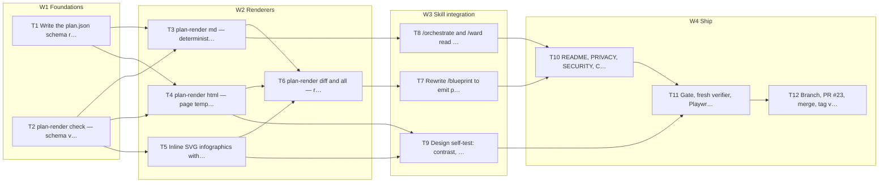

# Plan: Release 4.18.0 — static plan walkthrough

Version: v1 · Status: in_review · Spec: `.workspace/shared/specs/2026-11-01-plan-walkthrough.md`

Feature: plan-walkthrough-static · Steps: 12 (7 parallel, 5 sequential) · ~12.8 h

- Research: `.workspace/shared/research/2026-11-01-plan-walkthrough.md`

## Global Constraints
_Every task inherits these — do not restate per task._
- Python 3 stdlib only (no deps) for tools/
- bash 3.2 for scripts
- no network at review time
- existing /orchestrate and /ward keep reading plan.md
- scripts/gate.sh must stay GO

## Context

Today /blueprint writes a single plan.md and the approval gate is an AskUserQuestion in chat. 4.18.0 adds plan.json as the single source, a deterministic renderer that emits plan.md and plan.html, inline SVG infographics, and a page you can review step by step. The live round-trip (change requests from the page) is 4.19.0.

Stack: python, bash

| Blast radius | Files | Hits |
|---|---|---|
| `skills/blueprint/` | 3 | 3 |
| `skills/orchestrate/` | 2 | 1 |
| `skills/ward/` | 2 | 1 |
| `tools/` | 9 | 1 |
| `tests/claude/` | 21 | 3 |
| `docs (README…)` | 2 | 2 |

## Waves

- W1 Foundations: T1 (parallel), T2 (parallel)
- W2 Renderers: T3 (parallel), T4 (sequential), T5 (sequential), T6 (sequential)
- W3 Skill integration: T7 (parallel), T8 (parallel), T9 (parallel)
- W4 Ship: T10 (parallel), T11 (sequential), T12 (sequential)



> Execute waves in order; inside a wave, tasks marked *Parallel: YES* may run concurrently (they never share a modified file). Deferred tasks are listed at the end and are not executed.

## Tasks

### Task 1: Write the plan.json schema reference and a worked example (T1)
Parallel: YES

Wave: W1 · Kind: change · Layer: docs

Every later task renders from one structure, so the schema is fixed first. The reference documents each field, the validation rules (unique ids, resolvable depends_on, parallel steps never share a modify file inside a wave, every step has red.run and verify) and the size cap.

**Files:**
- Create: `skills/blueprint/references/plan-schema.md`, `skills/blueprint/references/plan-example.json`
- Modify: —
- Test: `tests/claude/fixtures/plans/valid.json`

- [ ] Write failing test: tests/claude/test_plan_render.py::test_example_matches_schema_doc — `assert set(example.keys()) == documented_top_level_keys`
- [ ] Run test: verify FAIL — `python3 -m unittest tests.claude.test_plan_render -k schema_doc`
- [ ] Implement: Write the reference from §4 of the design; copy its example into plan-example.json
- [ ] Run test: verify PASS — `python3 -m unittest tests.claude.test_plan_render -k schema_doc`
- [ ] Commit: `git commit -m "feat: Write the plan.json schema reference and a worked example"`

**Verify:** `python3 -m unittest tests.claude.test_plan_render` && `scripts/gate.sh`
**Touches:** schema, blueprint
**Risk:** low — documentation only
**Effort:** 30 min

```diff
+ skills/blueprint/references/plan-schema.md   (field table, validation rules)
+ skills/blueprint/references/plan-example.json (14-step csv-export sample)
```

Review: pending

### Task 2: plan-render check — schema validator (T2)
Parallel: YES

Wave: W1 · Kind: change · Layer: tools

A validator that fails loudly is what lets the LLM write JSON once and trust it. It cross-checks ids, dependencies, file conflicts between parallel steps, monotonic version, secrets (reusing magician-scan patterns) and the 256 KiB cap, exit code 2 on any error.

**Files:**
- Create: `tools/plan-render`
- Modify: —
- Test: `tests/claude/test_plan_render.py`, `tests/claude/fixtures/plans/invalid-*.json`

- [ ] Write failing test: tests/claude/test_plan_render.py::test_invalid_fixtures_fail_with_reason (12 cases) — `for f in invalid: rc, err = run('check', f); assert rc == 2 and expected[f] in err`
- [ ] Run test: verify FAIL — `python3 -m unittest tests.claude.test_plan_render -k invalid`
- [ ] Implement: argparse subcommands; load JSON; run rule functions in order; print one line per violation
- [ ] Run test: verify PASS — `python3 -m unittest tests.claude.test_plan_render -k invalid`
- [ ] Commit: `git commit -m "feat: plan-render check — schema validator"`

**Verify:** `python3 -m unittest tests.claude.test_plan_render` && `tools/plan-render check skills/blueprint/references/plan-example.json`
**Touches:** render, scan
**Risk:** low — pure function over JSON
**Effort:** 60 min

```diff
+ def check(plan):
+     for rule in (ids_unique, deps_resolve, no_parallel_file_conflicts,
+                  tdd_fields_present, touches_known, version_monotonic,
+                  no_secrets, size_cap):
+         yield from rule(plan)
```

Review: pending

### Task 3: plan-render md — deterministic plan.md (T3)
Parallel: YES (depends on Task 1, Task 2)

Wave: W2 · Kind: change · Layer: tools

plan.md keeps today's exact shape (### Task N, Parallel:, Files:, five TDD lines) so /orchestrate and /ward need no change on day one; deferred steps go under a separate heading and a sha256 trailer lets consumers detect a stale file.

**Files:**
- Create: —
- Modify: `tools/plan-render`
- Test: `tests/claude/test_plan_render.py`, `tests/claude/fixtures/plans/valid.md`

- [ ] Write failing test: tests/claude/test_plan_render.py::test_md_snapshot_byte_identical — `assert render_md(valid) == fixture('valid.md')`
- [ ] Run test: verify FAIL — `python3 -m unittest tests.claude.test_plan_render -k md_snapshot`
- [ ] Implement: string template per step; stable key order; trailing <!-- magician.plan/1 v1 sha256:… -->
- [ ] Run test: verify PASS — `python3 -m unittest tests.claude.test_plan_render -k md_snapshot`
- [ ] Commit: `git commit -m "feat: plan-render md — deterministic plan.md"`

**Verify:** `python3 -m unittest tests.claude.test_plan_render` && `diff <(tools/plan-render md example.json) tests/claude/fixtures/plans/valid.md`
**Touches:** render, orchestrate, ward
**Risk:** medium — format drift would break /orchestrate parsing — snapshot test guards it
**Effort:** 45 min

```diff
+ ### Task 3: Stream rows instead of buffering
+ Parallel: yes (after T1)
+ Files: create src/reports/stream.ts · modify src/reports/export.ts
+ - [ ] RED  tests/reports/stream.test.ts::streams_10k_rows
+ - [ ] GREEN …
+ Review: pending
```

Review: pending
Depends on: T1, T2

### Task 4: plan-render html — page template, tokens, player, map (T4)
Parallel: NO (depends on Task 1, Task 2)

Wave: W2 · Kind: change · Layer: tools

The walkthrough page itself: one file, inline CSS/JS, PLAN inlined as JSON with </ escaped, CSP that forbids any remote load, light theme by default with dark as the same tokens, player controls, wave timeline, SVG architecture map, step detail and side panel, keyboard map, reduced-motion path.

**Files:**
- Create: —
- Modify: `tools/plan-render`
- Test: `tests/claude/test_plan_render.py`, `tests/claude/fixtures/plans/valid.html`

- [ ] Write failing test: tests/claude/test_plan_render.py::test_html_snapshot_and_csp — `html = render_html(valid); assert 'Content-Security-Policy' in html; assert 'http://' not in strip_json(html); assert html == fixture('valid.html')`
- [ ] Run test: verify FAIL — `python3 -m unittest tests.claude.test_plan_render -k html`
- [ ] Implement: TEMPLATE constant with {{tokens}} {{plan}} slots; the page you are looking at is the reference implementation
- [ ] Run test: verify PASS — `python3 -m unittest tests.claude.test_plan_render -k html`
- [ ] Commit: `git commit -m "feat: plan-render html — page template, tokens, player, map"`

**Verify:** `python3 -m unittest tests.claude.test_plan_render` && `open plan.html from file:// and run the 25-item checklist`
**Touches:** render, lore, tokens
**Risk:** medium — largest task; template is ~700 lines of CSS/JS inside a Python string
**Effort:** 180 min

```diff
+ TEMPLATE = r'''<!DOCTYPE html>…<script type="application/json" id="plan">{{plan}}</script>…'''
+ def render_html(plan, theme='light'):
+     return TEMPLATE.replace('{{plan}}', json.dumps(plan).replace('</', '<\\/'))
```

Review: pending
Depends on: T1, T2

### Task 5: Inline SVG infographics with applicability rules (T5)
Parallel: NO (depends on Task 2)

Wave: W2 · Kind: change · Layer: tools

Charts only where the plan has the data: tasks per wave, effort by layer, parallel vs sequential, blast radius, critical path, risk matrix, per-step custom. No chart library; each SVG gets a title, a desc and a hidden data table; series use patterns as well as colour.

**Files:**
- Create: —
- Modify: `tools/plan-render`
- Test: `tests/claude/test_plan_render.py`

- [ ] Write failing test: tests/claude/test_plan_render.py::test_charts_only_when_data_exists — `assert '<svg' not in render_html(one_wave_plan).charts['tasks_per_wave']; assert all('<title>' in c for c in render_html(valid).charts.values())`
- [ ] Run test: verify FAIL — `python3 -m unittest tests.claude.test_plan_render -k charts`
- [ ] Implement: chart_bar(), chart_donut(), chart_gantt(), chart_matrix() returning SVG strings; a rules table decides which run
- [ ] Run test: verify PASS — `python3 -m unittest tests.claude.test_plan_render -k charts`
- [ ] Commit: `git commit -m "feat: Inline SVG infographics with applicability rules"`

**Verify:** `python3 -m unittest tests.claude.test_plan_render`
**Touches:** render
**Risk:** low — pure string generation
**Effort:** 90 min

Review: pending
Depends on: T2

### Task 6: plan-render diff and all — revision summary and one-shot pipeline (T6)
Parallel: NO (depends on Task 3, Task 4, Task 5)

Wave: W2 · Kind: change · Layer: tools

diff produces the what-changed summary between two plan versions (used by the page's changed badge in 4.19); all runs check → md → html and snapshots the previous version into history/.

**Files:**
- Create: —
- Modify: `tools/plan-render`
- Test: `tests/claude/test_plan_render.py`

- [ ] Write failing test: tests/claude/test_plan_render.py::test_all_writes_three_files_and_history — `run('all', v2); assert exists('plan.md','plan.html','history/plan.v1.json')`
- [ ] Run test: verify FAIL — `python3 -m unittest tests.claude.test_plan_render -k all`
- [ ] Implement: diff: walk steps by id, list changed fields; all: sequence the subcommands, atomic write via tmp + rename
- [ ] Run test: verify PASS — `python3 -m unittest tests.claude.test_plan_render -k all`
- [ ] Commit: `git commit -m "feat: plan-render diff and all — revision summary and one-shot pip"`

**Verify:** `python3 -m unittest tests.claude.test_plan_render` && `tools/plan-render all skills/blueprint/references/plan-example.json`
**Touches:** render
**Risk:** low
**Effort:** 40 min

Review: pending
Depends on: T3, T4, T5

### Task 7: Rewrite /blueprint to emit plan.json and render both documents (T7)
Parallel: YES (depends on Task 6)

Wave: W3 · Kind: change · Layer: skills

The skill becomes a ≤ 8 KB router: read spec/research/kg, map files, decompose, write plan.json, run plan-render all, open the page (static in 4.18), gate with AskUserQuestion. New arguments: review <plan-dir> and --static. New grants for plan-render and kg blast.

**Files:**
- Create: `skills/blueprint/references/walkthrough.md`, `skills/blueprint/references/revision-rules.md`
- Modify: `skills/blueprint/SKILL.md`
- Test: `tests/claude/test_frontmatter_strict.py`

- [ ] Write failing test: tests/claude/test_skills.py::test_blueprint_grants_and_size — `assert 'Bash(plan-render *)' in grants('blueprint'); assert size('skills/blueprint/SKILL.md') <= 8192`
- [ ] Run test: verify FAIL — `python3 -m unittest tests.claude.test_skills -k blueprint`
- [ ] Implement: Process section rewritten; references linked with ../../lore paths; fallback line for Claude chat (plan.md only)
- [ ] Run test: verify PASS — `python3 -m unittest tests.claude.test_skills -k blueprint`
- [ ] Commit: `git commit -m "feat: Rewrite /blueprint to emit plan.json and render both documen"`

**Verify:** `python3 -m unittest tests.claude.test_skills tests.claude.test_frontmatter_strict` && `claude plugin validate --strict`
**Touches:** blueprint, render, kg, schema, manifest
**Risk:** medium — behaviour change in a core skill — eval blueprint-emits-plan-json guards it
**Effort:** 90 min

```diff
- 4. Write the plan to .workspace/shared/plans/<date>-<feature>.md
+ 4. Write plan.json (schema: references/plan-schema.md)
+ 5. Run `plan-render all plan.json` → plan.md + plan.html + history/
+ 6. Tell the user the page path; gate with AskUserQuestion
```

Review: pending
Depends on: T6

### Task 8: /orchestrate and /ward read plan.json when present (T8)
Parallel: YES (depends on Task 3)

Wave: W3 · Kind: change · Layer: skills

Consumers prefer the structured plan (explicit waves, deferred steps excluded) and verify the plan.md trailer hash; when plan.json is absent they parse plan.md exactly as today, so older plans still run.

**Files:**
- Create: —
- Modify: `skills/orchestrate/SKILL.md`, `skills/ward/SKILL.md`
- Test: `tests/claude/test_skills.py`

- [ ] Write failing test: tests/claude/test_skills.py::test_consumers_mention_plan_json_and_fallback — `for s in ('orchestrate','ward'): body = read(s); assert 'plan.json' in body and 'plan.md' in body`
- [ ] Run test: verify FAIL — `python3 -m unittest tests.claude.test_skills -k consumers`
- [ ] Implement: One paragraph in each skill's input section: prefer plan.json, exclude review.status == deferred, check trailer
- [ ] Run test: verify PASS — `python3 -m unittest tests.claude.test_skills -k consumers`
- [ ] Commit: `git commit -m "feat: /orchestrate and /ward read plan.json when present"`

**Verify:** `python3 -m unittest tests.claude.test_skills`
**Touches:** orchestrate, ward, render
**Risk:** low — additive
**Effort:** 30 min

Review: pending
Depends on: T3

### Task 9: Design self-test: contrast, targets, motion, keyboard (T9)
Parallel: YES (depends on Task 4, Task 5)

Wave: W3 · Kind: verify · Layer: tests

The page is checked against the acquired design principles by code, not by eye: computed WCAG contrast for every token pair in both themes, 44 px boxes on every control, a prefers-reduced-motion block, a title and data table for every chart.

**Files:**
- Create: `tests/claude/test_plan_design.py`
- Modify: —
- Test: `tests/claude/test_plan_design.py`

- [ ] Write failing test: tests/claude/test_plan_design.py::test_contrast_aa_both_themes — `for theme in ('light','dark'): for fg,bg in pairs(theme): assert contrast(fg,bg) >= 4.5, (theme,fg,bg)`
- [ ] Run test: verify FAIL — `python3 -m unittest tests.claude.test_plan_design`
- [ ] Implement: parse the token maps out of TEMPLATE; relative-luminance formula; walk CSS for min-height/min-width on .btn
- [ ] Run test: verify PASS — `python3 -m unittest tests.claude.test_plan_design`
- [ ] Commit: `git commit -m "feat: Design self-test: contrast, targets, motion, keyboard"`

**Verify:** `python3 -m unittest tests.claude.test_plan_design` && `scripts/gate.sh`
**Touches:** t_design, render, lore
**Risk:** low
**Effort:** 60 min

Review: pending
Depends on: T4, T5

### Task 10: README, PRIVACY, SECURITY, CHANGELOG, version 4.18.0 (T10)
Parallel: YES (depends on Task 7, Task 8)

Wave: W4 · Kind: change · Layer: docs

Users learn what the new files are and where they are written; the security scope lists tools/plan-render; the changelog carries the release notes; plugin.json bumps the version.

**Files:**
- Create: —
- Modify: `README.md`, `PRIVACY.md`, `SECURITY.md`, `CHANGELOG.md`, `.claude-plugin/plugin.json`
- Test: `tests/claude/test_readme.py`

- [ ] Write failing test: tests/claude/test_readme.py::test_files_it_writes_lists_plans_dir — `assert 'plans/<feature>/' in readme_section('Files it writes')`
- [ ] Run test: verify FAIL — `python3 -m unittest tests.claude.test_readme`
- [ ] Implement: Skills row for /blueprint; Files-it-writes rows; CHANGELOG ## [4.18.0] — date
- [ ] Run test: verify PASS — `python3 -m unittest tests.claude.test_readme`
- [ ] Commit: `git commit -m "feat: README, PRIVACY, SECURITY, CHANGELOG, version 4.18.0"`

**Verify:** `python3 -m unittest tests.claude.test_readme` && `claude plugin validate --strict`
**Touches:** readme
**Risk:** low
**Effort:** 30 min

Review: pending
Depends on: T7, T8

### Task 11: Gate, fresh verifier, Playwright pass on the rendered page (T11)
Parallel: NO (depends on Task 9, Task 10)

Wave: W4 · Kind: verify · Layer: tests

scripts/gate.sh must be GO; a reviewer that has not seen the work re-reads the diff; a local Playwright script loads the static page, walks the keyboard map, checks the reduced-motion path and runs axe-core with zero serious violations.

**Files:**
- Create: `tests/e2e/plan_walkthrough.spec.js`
- Modify: —
- Test: `tests/e2e/plan_walkthrough.spec.js`

- [ ] Write failing test: tests/e2e/plan_walkthrough.spec.js — 'keyboard reaches every control' — `await page.keyboard.press('Tab') × n; expect(focusedIds).toEqual(expectedOrder)`
- [ ] Run test: verify FAIL — `npx playwright@1.56.0 test tests/e2e/plan_walkthrough.spec.js`
- [ ] Implement: fix whatever the gate, verifier or axe report
- [ ] Run test: verify PASS — `scripts/gate.sh && npx playwright@1.56.0 test`
- [ ] Commit: `git commit -m "feat: Gate, fresh verifier, Playwright pass on the rendered page"`

**Verify:** `scripts/gate.sh` && `npx playwright@1.56.0 test tests/e2e/plan_walkthrough.spec.js`
**Touches:** gate, t_render, t_design
**Risk:** medium — verifier findings are expected — 4.17 had 4 blockers on first pass
**Effort:** 90 min

Review: pending
Depends on: T9, T10

### Task 12: Branch, PR #23, merge, tag v4.18.0 (T12)
Parallel: NO (depends on Task 11)

Wave: W4 · Kind: rollout · Layer: docs

Ship on a feature branch through a REST-created PR (GraphQL is blocked in this environment), merge after GO, create the annotated tag on your machine and push it, then the GitHub Release.

**Files:**
- Create: —
- Modify: —
- Test: —

- [ ] Write failing test: n/a — rollout step
- [ ] Run test: verify FAIL — `gh api repos/:owner/magician/pulls -f head=feat/plan-walkthrough -f base=main`
- [ ] Implement: merge via REST; git tag -a v4.18.0; git push origin v4.18.0 (from your machine)
- [ ] Run test: verify PASS — `git push origin v4.18.0`
- [ ] Commit: `git commit -m "feat: Branch, PR #23, merge, tag v4.18.0"`

**Verify:** `gh api repos/:owner/magician/releases/tags/v4.18.0`
**Touches:** readme, gate
**Risk:** low — tag push blocked from the container — done on your machine, as for 4.17.0
**Effort:** 20 min

Review: pending
Depends on: T11

## Sources

- S1: [proposals/plan-walkthrough-design.md](proposals/plan-walkthrough-design.md)
- S2: lore/deep/design-principles.md#review-checklist
- S3: decisions/2026-11-01-v4.17.0-design-principles.md
- S4: adoption-deck.html (reference pattern)

<!-- magician.plan/1 v1 sha256:4e971ca02959d4a1627f1413409eaa7e3696fbfa1480842ceb9454ec793d2674 -->
